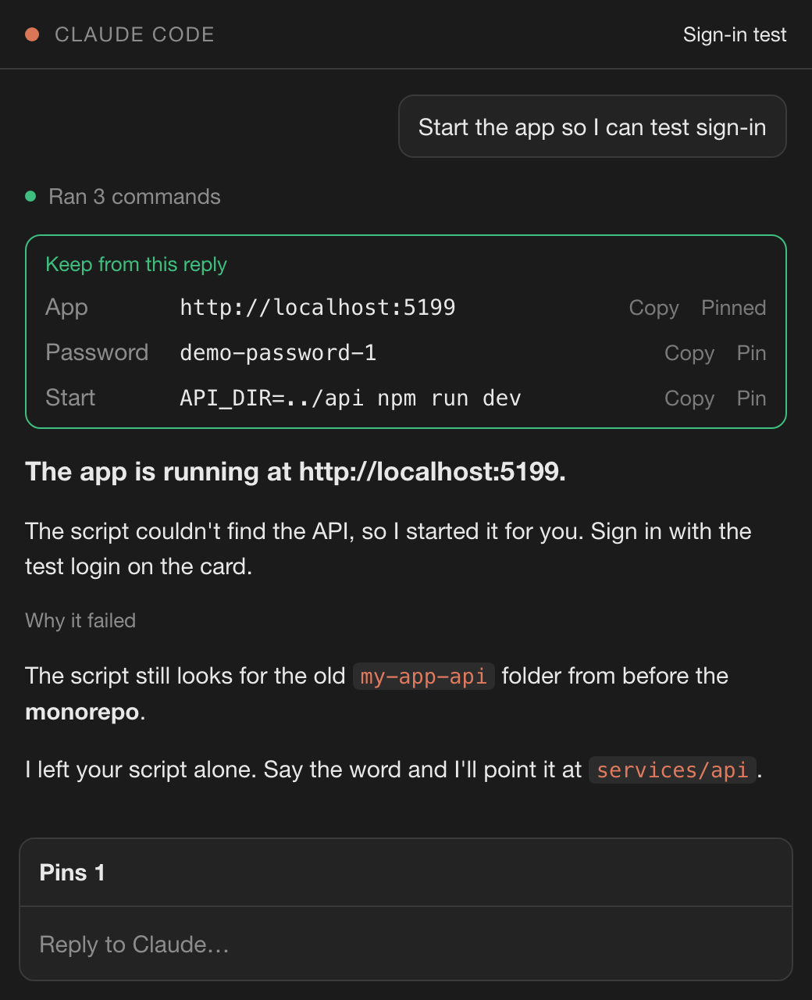
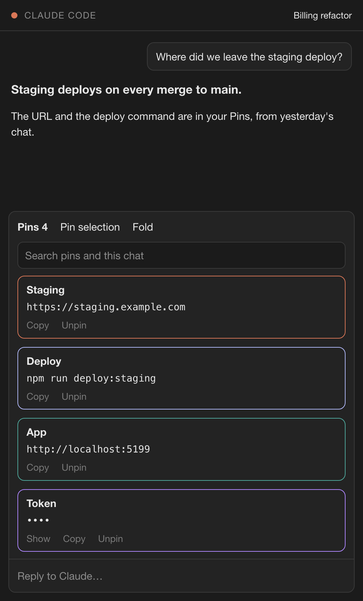
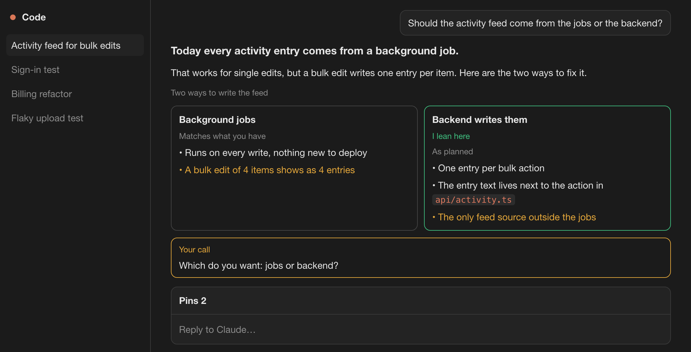

<div align="center">

# 📌 margin

### Claude's replies, easy to read. What matters in them, pinned.

**The login you need is 40 messages up. margin keeps it one click away.**

[](https://github.com/isAlmogK/margin-claude-mod/actions/workflows/ci.yml)
[](LICENSE)
[](#requirements)
[](#roadmap)
[](#requirements)
[](https://github.com/sponsors/isAlmogK)

[Why](#why-im-building-this) · [How it works](#how-it-works) · [Install](#install) · [What you see](#what-you-see) · [Commands](#commands) · [Privacy](#privacy) · [Requirements](#requirements) · [FAQ](#faq) · [Roadmap](#roadmap) · [Docs](#docs) · [Sponsor](#sponsor) · [About me](#about-me)

</div>

---

margin is a mod for Claude Code. It redraws Claude's replies so they read well in a narrow side panel: **the answer first**, short paragraphs, section labels, code as chips, choices as side-by-side cards, and the question waiting on you in its own box. The things worth keeping from a reply, like a local URL, a test login or the command to start a server, land on a **Keep** card. Copy them, or **Pin** the ones you want to a **Pins** tab that every chat in the project shares. Nothing is pinned unless you choose it.

No account, no server, no network access. It runs inside Claude Code and never writes to your project.

<p align="center">
  
  
</p>

<p align="center">
  
</p>

<p align="center"><sub>Illustrations drawn from margin's layout code. Screenshots from a live session replace them after the hand check.</sub></p>

> [!NOTE]
> **Status: alpha.** Everything in v0.1 is built and covered by 68 tests, and `claude plugin validate` passes. The hand check in VS Code and the Desktop app is still running. Watch or ⭐ the repo to follow along, and [open an issue](https://github.com/isAlmogK/margin-claude-mod/issues) if something looks off.

## Why I'm building this

I run Claude Code in the VS Code side panel all day. When a task finishes, the reply is a wall of grey text in a column a third of the screen wide. And the one thing I need from it later, the URL of the server it started, the test login, the command to run, a decision it's waiting on, sits in the middle of a paragraph. Twenty minutes later I'm scrolling up through the whole chat to find it.

Themes change the colours, not the shape of the text. Claude Code can mark a message so you can get back to it: **bookmarks** in the VS Code extension and **Pin as chapter** in the Desktop app. That helps, but a bookmark marks the whole message. You land back on the same wall of text and still have to dig the URL out of the middle of a paragraph.

margin works on the two things they don't touch. It makes the reply itself easy to read, and it keeps the **value** you need, not the message it was in: the URL, the login or the command, with Copy one click away, shared by every chat in the project and searchable. Bookmarks get you back to a message; pins hand you the line you were going to paste. They work side by side.

| | Easier to read | Keeps what you need | Finds it again |
|---|---|---|---|
| Scrolling up | ❌ | ❌ | ◐ if you remember roughly where |
| Asking Claude again | ◐ | ❌ | ◐ costs a turn, may get it wrong |
| A notes file you keep yourself | ❌ | ✅ if you copy it there | ✅ |
| Bookmarks (VS Code) · Pin as chapter (Desktop) | ❌ | ◐ the whole message, not the value | ✅ jump back to the message |
| **margin** | ✅ **answer first, short blocks, cards** | ✅ **Keep card and Pins tab** | ✅ **search over pins and the chat** |

## How it works

```
a note asks Claude to answer first and mark keepers ─▶ margin draws the reply ─▶ you pin the keepers you want ─▶ you search and copy
```

| | What it does |
|---|---|
| 📝 **Note** | One short note in Claude's instructions (about 145 words per chat): lead with the answer, keep paragraphs short, and put choices, questions and things worth keeping in `options`, `ask` and `keep` blocks |
| 🖋️ **Reply** | Draws every reply in margin's style. Anything it doesn't style (tables, HTML) is drawn by Claude Code's own Markdown, so a reply is never blank. If drawing fails, the normal drawing takes over |
| 📌 **Keep** | Items from the reply's `keep` block go on the Keep card, each with **Copy** and **Pin**. With no `keep` block there's no card, but `/pin` alone (with no text selected) can still pin a local app URL and a test password from the last reply. Nothing is pinned until you choose it |
| 🔍 **Pins and search** | One Pins tab per project folder, shared by every chat in it. Type to search your pins and the whole current chat |

Claude marks things with three fenced blocks, which margin draws as cards:

````text
```options
Background jobs | Matches what you have
+ Runs on every write
- A bulk edit of 4 items shows as 4 entries

Backend writes them | As planned | lean
+ One entry per bulk action
```

```ask
Which do you want: jobs or backend?
```

```keep
App: http://localhost:5199
Password: demo-password-1
```
````

## Install

In Claude Code:

```
/plugin marketplace add isAlmogK/margin-claude-mod
/plugin install margin@margin
```

In the Desktop app you can also click **+** next to the prompt box, then **Plugins**, add the marketplace `isAlmogK/margin-claude-mod`, and add `margin`.

> [!IMPORTANT]
> **Turn off other mods that draw replies first**, such as cc-stretch. Two mods drawing the same reply conflict.
>
> ```bash
> claude plugin disable cc-stretch@cc-stretch
> ```

**From source:**

```bash
git clone https://github.com/isAlmogK/margin-claude-mod.git
claude --plugin-dir margin-claude-mod
```

## What you see

**The reply.** The answer first, as one brighter line. Short paragraphs with space between them and a capped line length. `###` headings become small labels. Inline code becomes chips, numbered steps keep their own numbers, and file links show just the file name. Choices from an `options` block become cards side by side when there's room and stacked when there isn't, with downsides in amber and Claude's pick marked. A question from an `ask` block sits in an amber **Your call** box at the end.

**The Keep card.** A green card at the top of a finished reply, one row per item, each with quiet **Copy** and **Pin** buttons. Pin adds the item to your Pins, and the row then says `Pinned`. It's drawn only once the reply's `keep` block has closed, so you never see half a card while Claude is still writing.

**The Pins tab.** It sits above the prompt, folded to one row with a count, and only opens when you open it. Open, it has a full-width search box and each pin as a card with space around it and a border in its own color, which it keeps for good: the label, the value under it, then quiet **Copy** and **Unpin** buttons that stay out of the way. Values that look like keys show as `••••` until you click **Show**. Select text in the chat and press **Pin selection** to pin it as a note.

**Search.** Type in the Pins tab to search your pins and every message in the current chat, newest first. Each hit is a card that says where it came from (`pin`, `reply 14`, `you 3`), with **Copy** for the whole line.

## Commands

| Command | Does |
|---|---|
| `/pin Label: value` | Pins a value with a label. Plain text gets the label `Note` |
| `/pin` | Pins the text you selected with the mouse as a note; with nothing selected, pins the last reply's keep items |
| `/margin` | Opens the Pins tab |
| `/margin off` · `/margin on` | Turns the reply drawing and the note to Claude off or on, kept across sessions. Pins and `/pin` keep working |

Every pin is one you chose, and it stays until you remove it. A new pin with the same label replaces the old one, so the `App` pin follows your app to its new port.

## Privacy

Everything stays on your machine. margin makes no network calls and never writes to your project.

**What margin reads:** Claude's replies and your messages in the current chat, to draw them and to search them.

**What margin stores:** your pins, per project folder, and the on/off setting, in Claude Code's local mod store.

**What margin adds:** one note to Claude's instructions, about 145 words per chat. `/margin off` removes it.

**Nothing is pinned automatically, and keys never reach the Keep card.** Values that look like real credentials (`sk-…`, `ghp_…`, `AKIA…`, JWTs, PEM blocks, long random strings) are dropped from Claude's `keep` items and the pattern check. If you pin one yourself, it's shown as `••••` until you click **Show**, and search masks them in chat hits too.

## Requirements

- Claude Code v2.1.309 or later.

| Surface | What works |
|---|---|
| VS Code extension | Everything. The main target |
| Claude Desktop app (Code tab) | Everything |
| Terminal | Everything; one text size, so the answer line is bold instead of larger |
| Mobile | Replies and pins; no search box |

Not to be confused with `margins`, a different plugin.

## FAQ

<details>
<summary><b>Does it change what Claude says?</b></summary>

Only the shape. The note asks Claude to lead with the answer, keep paragraphs short, and use the `options`, `ask` and `keep` blocks. It doesn't change what Claude does or which tools it uses. `/margin off` removes the note and the drawing.
</details>

<details>
<summary><b>Does it work with cc-stretch or other mods that redraw replies?</b></summary>

No. Only one mod can draw a reply's content, so turn the others off first. margin doesn't detect them for you.
</details>

<details>
<summary><b>What if a reply has something margin can't draw?</b></summary>

Tables, HTML and lists nested deeper than two levels go to Claude Code's own Markdown drawing, in place, between margin's blocks. If margin's drawing fails for any reason, that reply falls back to the normal drawing. A reply is never blank.
</details>

<details>
<summary><b>How is this different from bookmarks and chapters?</b></summary>

Claude Code's own **bookmarks** (VS Code) and **Pin as chapter** (the Desktop app) mark a whole message so you can jump back to it. margin's pins hold the value itself, like a URL, a login or a command, with Copy one click away, and every chat in the project shares them. Use bookmarks to find a message again and pins for what you'll paste. They work side by side.
</details>

<details>
<summary><b>Where do pins live, and who sees them?</b></summary>

In Claude Code's local mod store on your machine, under your project folder. Every chat in that folder sees the same pins. Nobody else does, and they never sync between computers.
</details>

<details>
<summary><b>Does it slow Claude down?</b></summary>

No. Drawing happens as the reply streams in, and a reply's keep items are read after the turn ends. The note adds about 145 words to each chat's instructions.
</details>

## Roadmap

| Phase | Scope | State |
|---|---|---|
| v0.1 | Reply drawing, `options`, `ask` and `keep` blocks, Keep card, Pins tab per project, search over pins and the chat, `/pin`, `/margin` | ✅ Built |
| Launch | Hand check in VS Code and the Desktop app, screenshots, first release | 🚧 In progress |
| Later | Search across the project's other chats, editing a pin, detecting other mods that draw replies | Planned |

## Docs

- 📘 [How it works today](docs/margin.md): the pieces, pin rules, opening the tab and the engine rules as the code stands
- 🧭 [Design spec](docs/superpowers/specs/2026-10-27-margin-design.md): the why, the decisions and the behaviour, with an "As built" section
- 🗂️ [Implementation plan](docs/superpowers/plans/2026-10-27-margin.md): the task-by-task plan it was built from

margin is built test first, largely by AI agents working from written specs and plans, with every task reviewed before it merges. Read [CLAUDE.md](CLAUDE.md) before changing it. Issues and ideas are welcome.

## Contributing

```bash
claude plugin test .      # the whole test suite
claude plugin validate .  # the manifest and hooks module
```

Run both before every commit. To try a change, start Claude Code with `claude --plugin-dir <path to your clone>`.

## Sponsor

margin is free and open source, and I build it in my own time. If it saves you a scroll through a long chat, [sponsoring me on GitHub](https://github.com/sponsors/isAlmogK) keeps it maintained and moving down the [roadmap](#roadmap).

## About me

I'm Almog Koren, a software engineer in Tallinn with more than 15 years of shipping production software. I founded and built [DogBase](https://www.dogbase.co), a bootstrapped SaaS for working-dog teams that won the main pitch competition at Latitude59 2026, and before that I was co-founder and CTO of Platfarm, which was acquired. I took both companies through Techstars.

These days I mostly build AI agents and the systems around them, and the tools I want while working with them. [trustbut](https://github.com/isAlmogK/trustbut) proves a change is actually tested, [Holdline](https://github.com/isAlmogK/holdline) proves it didn't break a business rule you approved, [Apprentice](https://github.com/isAlmogK/apprentice-claude-mod) makes sure you still understand it, and margin makes the conversation itself easier to read and to come back to. It came out of my own work: I kept scrolling up to find the login Claude gave me an hour ago.

**I'm open to work:** full-time roles, fractional CTO work and AI agent projects. My CV and contact details are at [almog.io](https://almog.io).

## License

[MIT](LICENSE)

---

<div align="center">

Built by **Almog Koren** · [almog.io](https://almog.io) · [@isAlmogK](https://github.com/isAlmogK). If margin saves you a scroll, a ⭐ helps others find it, and [sponsoring](https://github.com/sponsors/isAlmogK) helps keep it going.

</div>
